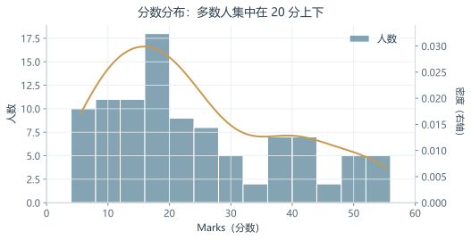
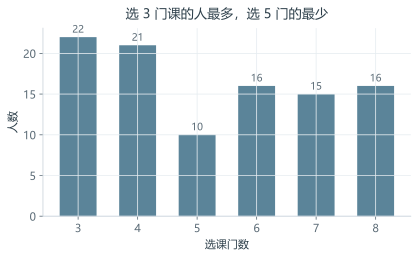
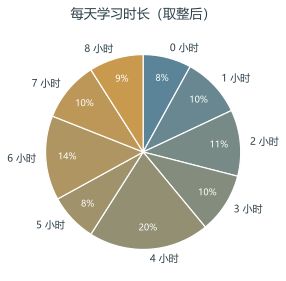
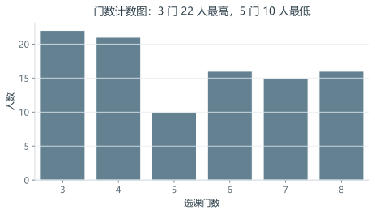
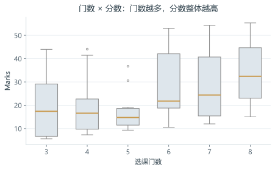
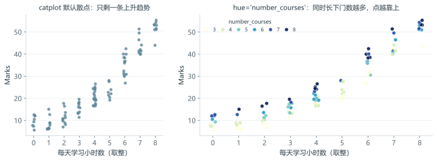
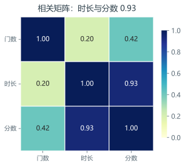
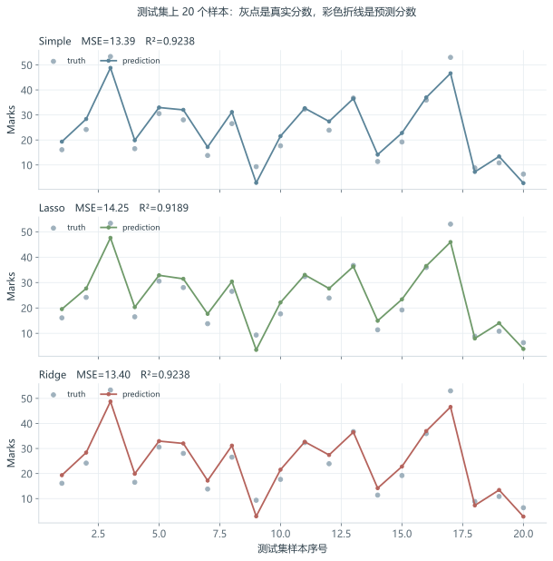
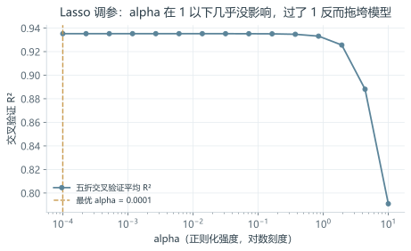

---
published: false
title: 实验4：数据分析
date: 2026-11-21 10:05:00
categories:
  - QUT
---

实验四用同一份学生成绩表做两遍数据挖掘：先靠画图做探索性分析（EDA），再用回归模型把分数算出来，最后调参、预测新样本。两条路走的是同一个问题——**选课门数和每天学习时长，能不能决定一个学生考多少分**。

`Student_Marks.csv` 只有一百条记录、三列：

| 字段 | 含义 |
| --- | --- |
| number_courses | 一学期选了几门课 |
| time_study | 平均每天学习多少小时，浮点数 |
| Marks | 期末分数，也就是要预测的目标向量 |

数据是干净的，没有缺失值，可以直接进分析：

```python
import pandas as pd

data = pd.read_csv(r'C:\Users\z123\Desktop\文档\大三\大数据\Student_Marks.csv')
print(data.shape)      # (100, 3)
data.info()            # 三列都 100 非空，number_courses 是 int64，另两列 float64
data.describe()        # 均值、标准差、最值、四分位数
```

`describe()` 先看一眼量纲：`number_courses` 在 3–8 之间，`time_study` 在 0.1–7.96 小时之间，`Marks` 从 5.6 到 55.3 分，均值 24.4，三列尺度差得不离谱，后面建模不用额外标准化。


## 一、可视化探索

### 1. 分数：直方图加密度曲线

```python
import matplotlib.pyplot as plt

data['Marks'].plot.hist()
data['Marks'].plot.density(secondary_y=True)
plt.show()
```

一个连续量先看形状：分数从 5.6 分到 55.3 分都有，**20 分上下的人最多**，30 分附近反而少。直方图给的是计数，密度曲线给的是概率密度，两者纵轴不同，所以第二根曲线要开 `secondary_y=True` 画在右边。



*图 1　分数分布：柱子数人数，右轴曲线是核密度估计，峰值落在 18 分左右*

### 2. 选课门数：它是整数，数人数就够

```python
data['number_courses'].value_counts() \
    .sort_values(axis=0) \
    .plot.bar()
plt.show()
```

`value_counts()` 数每个取值出现几次，`sort_values(axis=0)` 按行索引（也就是门数 1、2、3……）升序排，而不是按人数排。结果是选**三门课的最多**，五门的最少，整体还算平均。



*图 2　选课门数：3 门 22 人最多，5 门 10 人最少*

### 3. 学习时长：先取整，再画饼图

`time_study` 是 4.0771、2.3729 这种带四位小数的浮点数。学 4.077 小时和学 4.022 小时，成绩不该有区别，它们本来就该算同一类。这种「精度过剩」的连续量，最省事的处理是四舍五入取整，而不是硬套分箱：

```python
import numpy as np

data['hours'] = [int(np.round(i)) for i in data['time_study']]
print(data.head())
```

`[int(np.round(i)) for i in data['time_study']]` 是列表推导式：对序列里每个 `i` 做 `int(np.round(i))`，结果收成一个新列表。4.508 → 5，0.096 → 0，3.133 → 3。四舍五入比分箱更贴合「小时」这个语义单位。

取整之后它变成了离散量，可以数人数、可以画饼图：

```python
data['hours'].value_counts().sort_index(axis=0).plot.pie()
plt.show()
```

这里 `sort_index` 让扇区按小时数排列。学**4 小时的人最多**（20 人），其次 6 小时（14 人），5 小时和 0 小时各 8 人，是最少的。



*图 3　取整后的每日学时：4 小时这一档占了五分之一*

### 4. 门数 × 时长：计数图

单变量看完，进入两个变量。两个以上的变量用 seaborn 比较顺手：

```python
import seaborn as sns

sns.catplot(x='number_courses', kind='count', data=data)
plt.show()
```

`catplot` 默认画散点，`kind='count'` 换成计数图，纵轴自动变成人数。x 轴是六个离散取值，柱子一根根排开，一眼能数出每档多少人。



*图 4　门数计数图：3 门 22 人最高，5 门 10 人最低*


### 5. 门数 × 分数：箱线图

分数是连续量，没法像人数那样数，要看分布就用箱线图：

```python
sns.catplot(x='number_courses', y='Marks', kind='box', data=data)
plt.show()
```

这里出了一个反直觉的结果：**并不是选课越少分数越高**。按门数分组看中位数，选 5 门的最低（14.8 分），选 8 门的最高（32.4 分），门数越多分数整体越高；选 3 门的那组反而拉得最开，从 5.6 分到 44 分都有。箱线图的中位线、箱体、须和离群点，正好把「分布」和「极端值」分开了。



*图 5　门数 × 分数：箱体中位线一路抬高，3 门那组的箱体最扁最长*

### 6. 时长 × 分数：散点图

```python
sns.catplot(x='hours', y='Marks', data=data)              # kind 不写，默认散点
sns.catplot(x='hours', y='Marks', hue='number_courses', aspect=2, data=data)
plt.show()
```

横轴是取整后的整数，所以点排成一根根竖条，不像典型散点那样铺开。趋势非常清楚：**学得越久，分数的分布整体越高**，中位数从学 1 小时的 7.3 分一路爬到学 8 小时的 53 分。

`aspect=2` 是把图拉宽两倍，竖条密的时候更好读；`hue='number_courses'` 再塞进门数，能看出同样时长下选课多的那批人分数偏高——和上一张箱线图的结论一致。



*图 6　时长 × 分数：每个点是一个学生，颜色是选课门数，点整体往右上走*

### 7. 三列一起看：相关矩阵热图

```python
del data['time_study']       # 已取整成 hours，原列删掉；这行只能跑一次

corr = data.corr()
sns.heatmap(corr, annot=True, cmap='YlGnBu')
plt.show()
```

`data.corr()` 给出皮尔逊相关系数矩阵，`annot=True` 把数值写在格子里，`cmap='YlGnBu'` 是黄—绿—蓝的渐变（Yellow、Green、Blue 的首字母）。

读图：和 `Marks` 最相关的是 `hours`，相关系数约 **0.93**，强正相关，和散点图看到的一致；`number_courses` 与 `Marks` 也是正相关，但弱得多（0.42）；`number_courses` 和 `hours` 之间几乎没关系（0.20），两列特征没有共线，可以一起放进模型。



*图 7　相关矩阵：左上角 hours 与 Marks 的 0.93 最扎眼，另两个格子都偏浅*

### 8. 图表选择对照

| 数据组合 | 该用什么图 | 关键参数 |
| --- | --- | --- |
| 单个连续量 | 直方图 + 密度曲线 | `.plot.hist()`、`.plot.density(secondary_y=True)` |
| 单个离散量 | 条形图、饼图 | `value_counts().sort_values/sort_index().plot.bar()/plot.pie()` |
| 离散 × 离散 | 计数图 | `sns.catplot(kind='count', hue=...)` |
| 离散 × 连续 | 箱线图或散点图 | `kind='box'`；默认就是散点 |
| 多个变量 | 相关热图 | `sns.heatmap(df.corr(), annot=True)` |

选图之前问三句：目标变量是什么类型，要比较的是分布还是关系，变量里有几个是离散的。

### EDA 给出的三条结论

1. 学习时长和分数强正相关（r≈0.93），时长是最有解释力的变量；
2. 选课门数和分数正相关，选得多的反而考得好，这条和直觉相反；
3. 同样学习时长下，选课多的学生分数更高，说明两列特征之间存在交互。

大数据分析在这一步只描述「数据里呈现了什么」，不急着解释因果：选课多的学生可能本身更自律、专业基础更好，但这是猜测，数据只回答相关。

## 二、机器学习建模

### 1. 一次建模的五个动作

把上面的问题形式化：任务是预测连续值，所以是**回归**；数据里有真实分数作为标签，所以是**监督学习**。用 Tom Mitchell 的说法，一个程序在任务 T 上的表现 P 随经验 E 提高，才叫学习——这里的 T 是「预测分数」，P 是「误差有多小」，E 是一百条历史记录。

流程固定为五步：分离特征与目标 → 划分训练集和测试集 → 建模型训练 → 在测试集上预测 → 评估。调参和预测新样本是后面两步的延伸。

### 2. 分离目标向量

```python
X = data[['number_courses', 'time_study']]   # 特征是两列，双层方括号
y = data['marks']
```

**切多列要用两层方括号**，`data['number_courses', 'time_study']` 会被当成元组索引而报错；切单列用一层，得到的是一维 Series。变量名习惯用大写 `X`，只是命名习惯，不影响结果。

### 3. 划分训练集与测试集

```python
from sklearn.model_selection import train_test_split

x_train, x_test, y_train, y_test = train_test_split(
    X, y,
    test_size=0.2,      # 测试集占 20%
    random_state=2)     # 固定随机种子
```

划分是随机的，`random_state` 固定之后每次划分结果都一样，实验才可复现。**返回值的顺序是固定的**：先 `x_train`、再 `x_test`、再 `y_train`、最后 `y_test`，接反了不报错但全错。

### 4. 建三个模型

```python
from sklearn.linear_model import LinearRegression, Lasso, Ridge

simple = LinearRegression()
lasso = Lasso()
ridge = Ridge()

simple.fit(x_train, y_train)
lasso.fit(x_train, y_train)
ridge.fit(x_train, y_train)
```

三个都是线性回归系，区别在**正则化**：`Lasso` 用 L1 惩罚，会把不重要的系数压到 0，等于自动选特征；`Ridge` 用 L2 惩罚，把系数整体往小压但不压到 0。默认的 `LinearRegression` 不加惩罚，只求最小二乘。

`fit` 之后模型参数（权重 w 和截距 b）就从训练数据里算出来了——这就是「参数由数据估计」的意思。

### 5. 在测试集上预测

```python
y_predict_simple = simple.predict(x_test)
y_predict_lasso = lasso.predict(x_test)
y_predict_ridge = ridge.predict(x_test)
```

`predict` 里必须传 `x_test`。往年最常出现的错误是把 `x_train` 传进去：在训练集上训练、又在训练集上预测，模型见过这些数据，结果必然漂亮，但毫无意义。要衡量的是**泛化能力**，也就是在没见过的新数据上表现如何。

### 6. 评估：MSE 与 R²

```python
from sklearn.metrics import mean_squared_error, r2_score

mse_simple = mean_squared_error(y_test, y_predict_simple)
r2_simple = r2_score(y_test, y_predict_simple)
```

两个参数的顺序也是固定的：**真实值在前，预测值在后**，而且每个模型只能配自己的预测值，张冠李戴不会报错。

- **MSE（均方误差）**：预测值和真实值之差的平方的平均值，单位是分数的平方，越小越好；
- **R²（可决系数）**：模型解释了目标变量多少比例的方差，取值 0–1，越大越好，0.9 意味着九成的分数波动被解释掉了。

一百条数据、两个特征，三个模型的结果几乎一样：

| 模型 | MSE | R² |
| --- | --- | --- |
| 简单线性回归 | 13.39 | 0.9238 |
| Lasso | 14.25 | 0.9189 |
| Ridge | 13.40 | 0.9238 |

简单线性回归和 Ridge 几乎打平，Lasso **最差**，所以下一步拿它去调参。

### 7. 把真实值和预测值画在一起

```python
plt.figure(figsize=(10, 12))
plt.style.use('seaborn-darkgrid')      # 新版 matplotlib 要写成 seaborn-v0_8-darkgrid
plt.rcParams['xtick.labelsize'] = 10
plt.rcParams['ytick.labelsize'] = 10

x_range = np.arange(1, len(x_test) + 1)

plt.subplot(3, 1, 1)
plt.title('Simple')
plt.scatter(x_range, y_test, label='truth')
plt.plot(x_range, y_predict_simple, 'b-', label='prediction')
plt.ylabel('Marks')
plt.legend(loc='best')
```

三幅子图竖排，`subplot(3, 1, n)` 的三个参数是行数、列数、第几幅（先行后列，从左到右编号）。每幅图里，散点是测试集每个样本的**真实分数**，折线是**预测分数**，两条贴得越近越好。

另外两幅只是换了颜色和模型：Lasso 用 `'g-'`，图例 `loc='lower left'`；Ridge 用 `'r-'`，图例 `loc='upper center'`。折线格式串里 `b/g/r` 是 blue/green/red 的首字母，`-` 是实线。

`x_range` 用 `np.arange(1, len(x_test) + 1)`：`arange` 左闭右开，所以要 +1 才凑够样本数，否则折线会短一截。



*图 8　三模型对照：灰点是真实分数，折线是预测，标题里带各自的 MSE 与 R²*

### 8. 调参：交叉验证 + 网格搜索

要调的是 Lasso 的正则化系数 `alpha`。它不属于参数，因为它没法从数据里估出来，只能人给——这属于**超参数**。

挑超参数不能拿测试集挑（那样测试集就变成训练数据了），常见做法是**交叉验证**：把训练集分成 k 份，轮流拿 1 份当验证集、其余 k−1 份训练，跑 k 轮取平均。五折就是每份都当过一次验证集，比一次性留出验证集更省数据。

```python
from sklearn.model_selection import GridSearchCV

alpha_values = np.logspace(-4, 1, 15)      # 10^-4 到 10^1，等比取 15 个

lasso_cv = GridSearchCV(
    estimator=Lasso(),
    param_grid={'alpha': alpha_values},
    cv=5)

lasso_cv.fit(x_train, y_train)
optimal = lasso_cv.best_params_['alpha']
print(optimal)      # 0.0001
```

`GridSearchCV` 的做法就是把参数网格里的每个组合都试一遍，每个组合用五折交叉验证算一个平均分，取最好的那个。`param_grid` 是字典：参数名作键，候选值列表作值。`best_params_` 结尾有下划线——sklearn 的约定是**训练后才知道的属性都带下划线**。

用最优值重建模型：

```python
best_lasso = Lasso(alpha=optimal)
best_lasso.fit(x_train, y_train)
y_pred_best = best_lasso.predict(x_test)

print(r2_score(y_test, y_pred_best))            # 0.9238
print(mean_squared_error(y_test, y_pred_best))  # 13.39
```

MSE 从 14.25 降到 13.39，R² 从 0.9189 升到 0.9238，正好追平了不加惩罚的线性回归。`alpha` 落在网格下界 1e-4，说明这份数据几乎不需要正则化——一百条样本、两个特征，本身就不容易过拟合，惩罚再重只会让模型欠拟合。



*图 9　五折交叉验证：alpha 小于 1 时 R² 几乎不动，超过 1 之后一路掉到 0.79*

### 9. 用最终模型预测新样本

```python
new_data = np.array([3, 2]).reshape(1, -1)
print(best_lasso.predict(new_data))      # 9.23 分

new_data = np.array([8, 7]).reshape(1, -1)
print(best_lasso.predict(new_data))      # 45.34 分
```

`predict` 要的是一张二维表：行是样本、列是特征。手工给一个样本时，先 `np.array([3, 2])` 变成一维数组，再 `reshape(1, -1)` 变成一行两列——`-1` 让 numpy 自己算列数。少这一句会报「期望 2 维，得到 1 维」。

选 3 门课、每天学 2 小时，预测 9.23 分；选 8 门课、每天学 7 小时，预测 45.34 分。把这两个结果和前面的散点图、热图放在一起看，结论是自洽的：时长是主因，门数是次因。

## 三、小结

整条链路是从描述走到建模：单变量先看清形状，两两关系里找到主因，相关矩阵确认两列特征不共线，最后用两个特征把 R² 做到 0.92。直方图确认分数是连续量，所以选回归而不是分类；散点说明时长是主因；箱线图发现门数也有用，这也解释了为什么 Lasso 把门数的系数压到 0 之后反而变差。

方法论上有两条收获。第一，画图和建模是同一个问题的两种问法：EDA 负责发现关系，模型负责量化关系并外推，两者用的是同一份数据、同一个目标变量，不该割裂开做。第二，调参之前先看清模型为什么差——Lasso 在这份数据上「差」只是因为正则化没调好，把 alpha 调小就追平了，而不是算法本身不行。


# 附完整代码（pycharm环境）


```python
import numpy as np
import pandas as pd
import matplotlib.pyplot as plt
import seaborn as sns

plt.rcParams["font.sans-serif"] = ["Microsoft YaHei"]
plt.rcParams["axes.unicode_minus"] = False

FILE = r"D:\0-LEARN_PROJECT\ML\exp4-ml\Student_Marks.csv"

# %% 1 读取数据
data = pd.read_csv(FILE)
print(data.head())

# %% 2 查看数据信息
print(data.info())
print(data.describe())

# %% 3 分数：直方图 + 密度图
data["Marks"].plot.hist()
data["Marks"].plot.density(secondary_y=True)
plt.show()

# %% 4 选课门数：条形图
data["number_courses"].value_counts().sort_values(axis=0).plot.bar()
plt.show()

# %% 5 学习时长：四舍五入取整后画饼图
data["hours"] = [int(np.round(i)) for i in data["time_study"]]
data["hours"].value_counts().sort_index(axis=0).plot.pie()
plt.show()

# %% 6 门数 × 时长：计数图
sns.catplot(x="number_courses", kind="count", data=data)
sns.catplot(x="number_courses", hue="hours", kind="count", data=data)
plt.show()

# %% 7 门数 × 分数：箱线图
sns.catplot(x="number_courses", y="Marks", kind="box", data=data)
plt.show()

# %% 8 时长 × 分数：散点图
sns.catplot(x="hours", y="Marks", data=data)
sns.catplot(x="hours", y="Marks", hue="number_courses", aspect=2, data=data)
plt.show()

# %% 9 相关性热图
del data["time_study"]
corr = data.corr()
sns.heatmap(corr, annot=True, xticklabels=True, yticklabels=True, cmap="YlGnBu")
plt.show()

# ---------------- 机器学习部分 ----------------

# %% 10 重新读取数据，分离目标向量（EDA 里删过 time_study，这里重新读一次）
data = pd.read_csv(FILE)
X = data[["number_courses", "time_study"]]
y = data["Marks"]
print(X.shape, y.shape)

# %% 11 划分训练集和测试集
from sklearn.model_selection import train_test_split

x_train, x_test, y_train, y_test = train_test_split(
    X, y, test_size=0.2, random_state=2)
print(x_train.shape, x_test.shape)

# %% 12 创建并训练模型
from sklearn.linear_model import LinearRegression, Lasso, Ridge

simple = LinearRegression()
lasso = Lasso()
ridge = Ridge()

simple.fit(x_train, y_train)
lasso.fit(x_train, y_train)
ridge.fit(x_train, y_train)

for name, model in [("Simple", simple), ("Lasso", lasso), ("Ridge", ridge)]:
    print(name, model.coef_.round(4), round(model.intercept_, 4))

# %% 13 在测试集上预测
y_predict_simple = simple.predict(x_test)
y_predict_lasso = lasso.predict(x_test)
y_predict_ridge = ridge.predict(x_test)

# %% 14 评估：均方误差 MSE 与决定系数 R2
from sklearn.metrics import mean_squared_error, r2_score

mse_simple = mean_squared_error(y_test, y_predict_simple)
mse_lasso = mean_squared_error(y_test, y_predict_lasso)
mse_ridge = mean_squared_error(y_test, y_predict_ridge)
print(mse_simple, mse_lasso, mse_ridge)

r2_simple = r2_score(y_test, y_predict_simple)
r2_lasso = r2_score(y_test, y_predict_lasso)
r2_ridge = r2_score(y_test, y_predict_ridge)
print(r2_simple, r2_lasso, r2_ridge)

# %% 15 结果可视化：真实值为散点，预测值为折线
plt.style.use("seaborn-v0_8-darkgrid")
plt.figure(figsize=(10, 12))
plt.rcParams["xtick.labelsize"] = 10
plt.rcParams["ytick.labelsize"] = 10

x_range = np.arange(1, len(x_test) + 1)

plt.subplot(3, 1, 1)
plt.title("Simple")
plt.scatter(x_range, y_test, label="truth")
plt.plot(x_range, y_predict_simple, "b-", label="prediction")
plt.ylabel("Marks")
plt.legend(loc="best")

plt.subplot(3, 1, 2)
plt.title("Lasso")
plt.scatter(x_range, y_test, label="truth")
plt.plot(x_range, y_predict_lasso, "g-", label="prediction")
plt.ylabel("Marks")
plt.legend(loc="lower left")

plt.subplot(3, 1, 3)
plt.title("Ridge")
plt.scatter(x_range, y_test, label="truth")
plt.plot(x_range, y_predict_ridge, "r-", label="prediction")
plt.ylabel("Marks")
plt.legend(loc="upper center")
plt.show()

# %% 16 调优 Lasso：交叉验证 + 网格搜索
from sklearn.model_selection import GridSearchCV

alpha_values = np.logspace(-4, 1, 15) # 从 0.0001 到 10，生成 15 个比值相等的数

lasso_cv = GridSearchCV(
    estimator=Lasso(),
    param_grid={"alpha": alpha_values},
    cv=5)
lasso_cv.fit(x_train, y_train)

optimal = lasso_cv.best_params_["alpha"]
print(optimal) # 0.0001

best_lasso = Lasso(alpha=optimal)
best_lasso.fit(x_train, y_train)
y_pred_best = best_lasso.predict(x_test)
print(r2_score(y_test, y_pred_best))
print(mean_squared_error(y_test, y_pred_best))

# %% 17 用最终模型预测新数据
new_data = np.array([3, 2]).reshape(1, -1)
print(best_lasso.predict(new_data))

new_data = np.array([8, 7]).reshape(1, -1)
print(best_lasso.predict(new_data))

```
